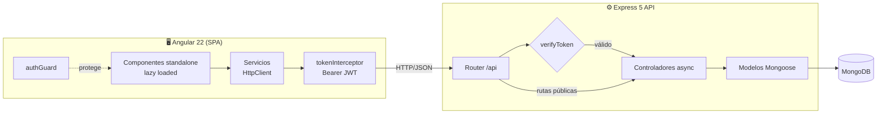

<div align="center">


# 🏡 Inmobiliaria · Full Stack MEAN

**Plataforma web para publicar, buscar y administrar propiedades en venta,**
**con autenticación JWT y panel de administración.**

[](https://angular.dev)
[](https://www.typescriptlang.org)
[](https://material.angular.dev)
[](https://nodejs.org)
[](https://expressjs.com)
[](https://mongoosejs.com)
[](https://jwt.io)
[](https://vitest.dev)

[Características](#-características) ·
[Arquitectura](#-arquitectura) ·
[Instalación](#-instalación) ·
[API](#-api-rest) ·
[Modernización](#-modernización-angular-9--22)

</div>

---

## ✨ Características

| | |
|---|---|
| 🏠 **Catálogo de propiedades** | Listado de anuncios con detalle por propiedad: baños, dormitorios, m², ubicación, valor, plano y fotografías. |
| 🔐 **Autenticación JWT** | Registro e inicio de sesión con contraseñas cifradas con **bcrypt** y tokens firmados que expiran a las 24 h. |
| 🛡️ **Rutas protegidas** | `authGuard` en el frontend y un middleware `verifyToken` en el backend protegen todas las operaciones de escritura. |
| 🔁 **Interceptor HTTP** | Un interceptor funcional agrega el header `Authorization: Bearer` a cada petición automáticamente. |
| 📊 **Panel de administración** | CRUD de propiedades con tabla **Angular Material**: búsqueda en vivo, orden por columna y paginación en español. |
| ✉️ **Formulario de contacto** | Los clientes envían consultas de compra o arriendo, que se guardan en MongoDB. |
| 📰 **Blog** | Sección de entradas con API REST completa. |
| ⚡ **Carga diferida** | Cada página es un componente standalone con *lazy loading*, lo que deja un bundle inicial de **~130 kB** comprimido. |

## 🧱 Stack tecnológico

**Frontend**
- Angular 22 con **componentes standalone**, `inject()` y el nuevo *control flow* (`@if`, `@for`)
- Angular Material (tablas, paginador, ordenamiento, *expansion panels*)
- RxJS 7 · TypeScript 6
- Builder `@angular/build` (esbuild + Vite)
- Tests unitarios con **Vitest**

**Backend**
- Node.js 24 + **Express 5**, con manejo nativo de errores en controladores `async`
- MongoDB + **Mongoose 9**
- `jsonwebtoken` + `bcryptjs` para la autenticación
- Configuración por variables de entorno (`--env-file`, sin dependencias extra)
- Recarga en caliente con `node --watch`

## 🏗 Arquitectura



El backend se organiza por **módulos de dominio**. Cada uno tiene su modelo, su capa de acceso a datos (DAO), su controlador y sus rutas:

```
server/
├── config/            # Variables de entorno y conexión a MongoDB
├── middlewares/       # verifyToken (JWT)
└── objetos/
    ├── auth/          # Usuarios: registro, login, CRUD
    ├── propiedades/   # CRUD de propiedades
    ├── blogs/         # CRUD de entradas del blog
    └── contacto/      # Mensajes de contacto

inmobiliaria/src/app/
├── Componentes/
│   ├── _layout/        # Header, nav, footer y layouts
│   ├── PagesExternas/  # Landing: home, anuncios destacados, testimonios
│   └── PagesInternas/  # Anuncios, detalle, blog, contacto, auth, administración
├── Servicios/          # Servicios HTTP, authGuard, tokenInterceptor
├── Model/ · Interfaces/
├── app.config.ts       # Providers (router, HttpClient, interceptores)
└── app.routes.ts       # Rutas con carga diferida
```

## 🚀 Instalación

**Requisitos:** Node.js 22.22+ o 24.15+ y una instancia de MongoDB (local o [Atlas](https://www.mongodb.com/atlas)).

```bash
git clone https://github.com/camidesarrollo/inmobiliaria-angular.git
cd inmobiliaria-angular
```

**1. Backend**

```bash
cd server
npm install
cp .env.example .env
# Genera una clave segura para JWT_SECRET:
node -e "console.log(require('crypto').randomBytes(48).toString('hex'))"
npm run dev          # http://localhost:3000
```

**2. Frontend** (en otra terminal)

```bash
cd inmobiliaria
npm install
npm start            # http://localhost:4200
```

| Comando (frontend) | Descripción |
|---|---|
| `npm start` | Servidor de desarrollo con recarga en caliente |
| `npm run build` | Build de producción en `dist/inmobiliaria` |
| `npm test` | Tests unitarios con Vitest |

## 📡 API REST

Base: `http://localhost:3000` · 🔒 = requiere `Authorization: Bearer <token>`

| Método | Endpoint | Descripción | |
|---|---|---|---|
| `POST` | `/register` | Registra un usuario y devuelve un JWT | |
| `POST` | `/login` | Inicia sesión y devuelve un JWT | |
| `GET` | `/api/usuarios` | Lista usuarios (sin contraseñas) | 🔒 |
| `PUT` · `DELETE` | `/api/usuarios/:id` | Edita o elimina un usuario | 🔒 |
| `GET` | `/api/propiedades` | Lista propiedades | |
| `GET` | `/api/propiedades/:id` | Detalle de una propiedad | |
| `POST` | `/api/propiedades` | Crea una propiedad | 🔒 |
| `PUT` · `DELETE` | `/api/propiedades/:id` | Edita o elimina una propiedad | 🔒 |
| `GET` | `/api/Blogs` · `/api/Blogs/:id` | Lista o muestra entradas | |
| `POST` · `PUT` · `DELETE` | `/api/Blogs[/:id]` | Gestiona las entradas | 🔒 |
| `POST` | `/api/contacto` | Envía un mensaje de contacto | |

Las respuestas de error son consistentes: `400` para validación o ID inválido, `401` para token ausente o inválido, `404` para recurso inexistente y `409` para un email ya registrado.

## 🔄 Modernización: Angular 9 → 22

El proyecto nació en Angular 9 y lo migré completo a la versión actual. Esto fue lo que cambió:

| Antes | Ahora |
|---|---|
| Angular 9, TypeScript 3.7 | **Angular 22**, TypeScript 6 |
| `NgModule` + `loadChildren` como string | **Componentes standalone** + `bootstrapApplication` + `loadComponent` |
| `*ngIf` / `*ngFor` | Nuevo *control flow*: `@if` / `@for` |
| Inyección por constructor | Función `inject()` |
| Guard e interceptor como clases | `CanActivateFn` y `HttpInterceptorFn` funcionales |
| jQuery + DataTables | **Angular Material Table** (sin jQuery) |
| Webpack · Karma · Protractor · TSLint | **esbuild/Vite** · **Vitest** |
| Express 4 + Mongoose 5 con callbacks | **Express 5** + **Mongoose 9** con `async/await` |
| Clave JWT escrita en el código | Variables de entorno, con error si falta la clave |
| `nodemon` | `node --watch` nativo |

**Resultado:** el bundle inicial bajó de **988 kB a 579 kB** (de ~229 kB a ~130 kB comprimido) y desaparecieron dependencias obsoletas.

## 👤 Autoría

Desarrollado por **[@camidesarrollo](https://github.com/camidesarrollo)**.

[](https://github.com/camidesarrollo)

<div align="center">

⭐ Si te gustó el proyecto, ¡deja una estrella!

</div>
